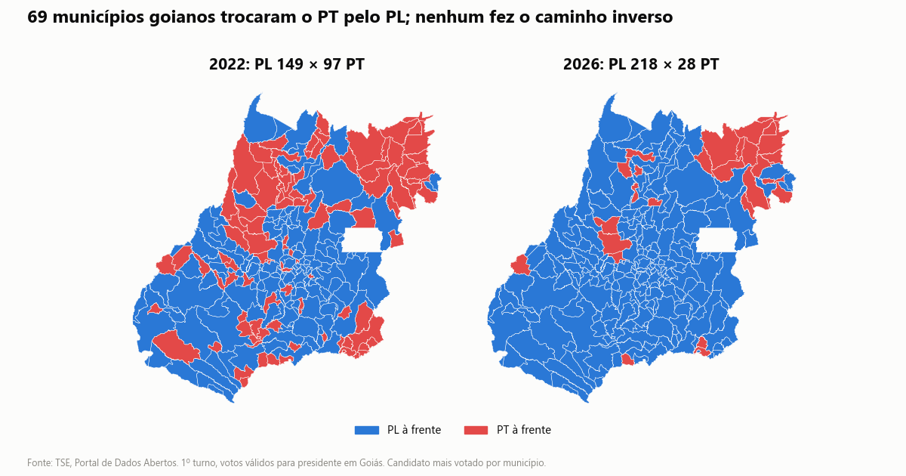

# Presidente em Goiás: 2022 x 2026

Comparação do 1º turno para presidente nos 246 municípios de Goiás, com dados abertos do TSE.

**Painel interativo:** https://jeffairdata.github.io/eleicoes-goias-2022-2026/

## O que os dados mostram

| | 2022 | 2026 |
|---|---|---|
| PL (Jair Bolsonaro / Flávio Bolsonaro) | 52,2% | 53,6% |
| PT (Lula) | 39,5% | 31,1% |
| Ronaldo Caiado (PSD) | – | 12,3% |
| Municípios com PL à frente | 149 | 218 |
| Municípios com PT à frente | 97 | 28 |
| Abstenção | 21,7% | 21,8% |
| Eleitores aptos | 4.870.292 | 5.080.590 |
| Eleitores com 60 anos ou mais | 18,5% | 21,7% |
| Eleitores de 16 a 29 anos | 24,8% | 22,0% |

- Lula recuou em todos os 246 municípios, entre 4,6 e 24,5 pontos percentuais.
- 69 municípios passaram do PT para o PL; nenhum fez o caminho inverso.
- O PL cresceu em 201 municípios e caiu em 45, entre eles Goiânia (56,1% para 54,7%).
- Caiado teve de 3,5% a 32,3% dos válidos conforme o município.
- A abstenção ficou estável e o eleitorado envelheceu.





## Dados

Em `Data/processed/`, em Parquet e CSV:

| Arquivo | Conteúdo |
|---|---|
| `presidente_go_votos` | votos válidos por município, candidato, ano e turno |
| `presidente_go_comparecimento` | aptos, comparecimento, abstenção, brancos e nulos por município |
| `eleitorado_go_perfil` | eleitorado por município: sexo, faixa etária e escolaridade |
| `resumo_municipios_go.csv` | uma linha por município com os indicadores dos gráficos |

Fonte: [Portal de Dados Abertos do TSE](https://dadosabertos.tse.jus.br/), arquivos `votacao_candidato_munzona`, `detalhe_votacao_munzona` e `perfil_eleitor_secao`. Os dados de 2026 são da extração de 11/10/2026 e podem ser atualizados pelo TSE. Malha municipal: IBGE 2020, via `geobr`.

## Como reproduzir

```bash
python -m venv .venv
.venv\Scripts\activate          # Linux/Mac: source .venv/bin/activate
pip install -r requirements.txt
python src/download_tse.py      # cerca de 1,1 GB
python src/build_dataset.py
python src/build_charts.py
```

## Limite da análise

Os dados são agregados por município: mostram onde o voto mudou, não quem mudou de voto.
