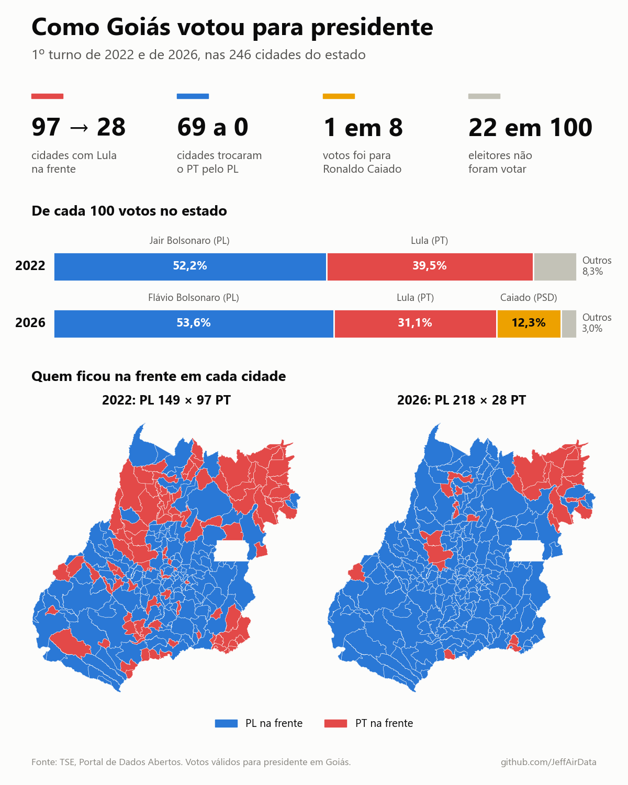
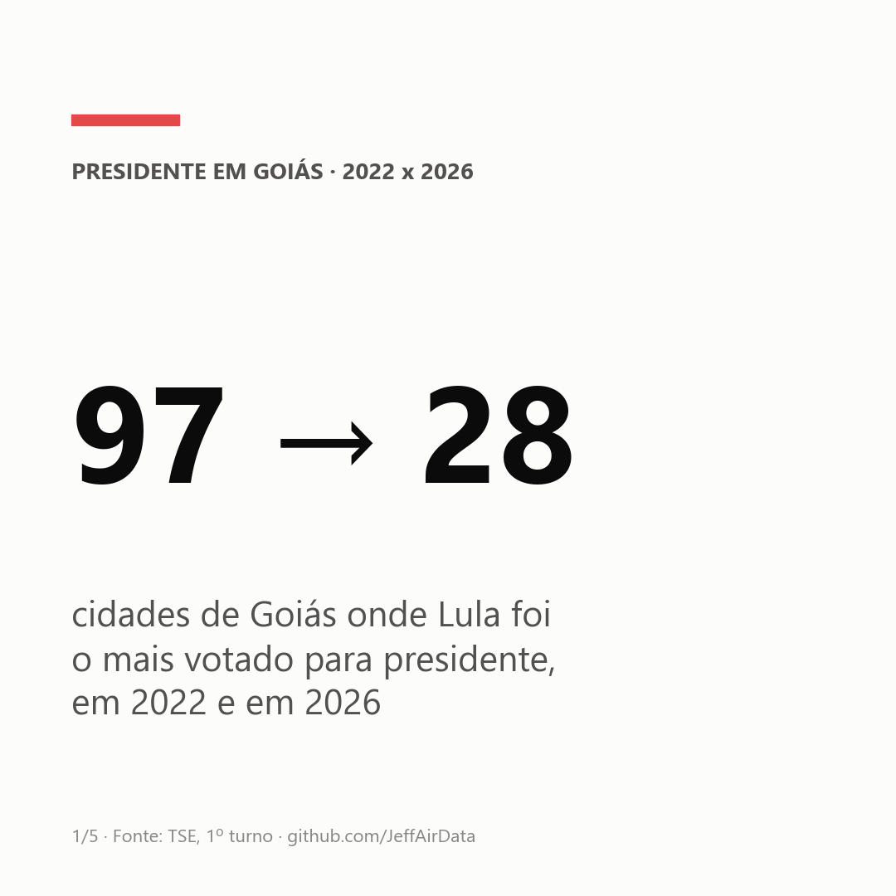
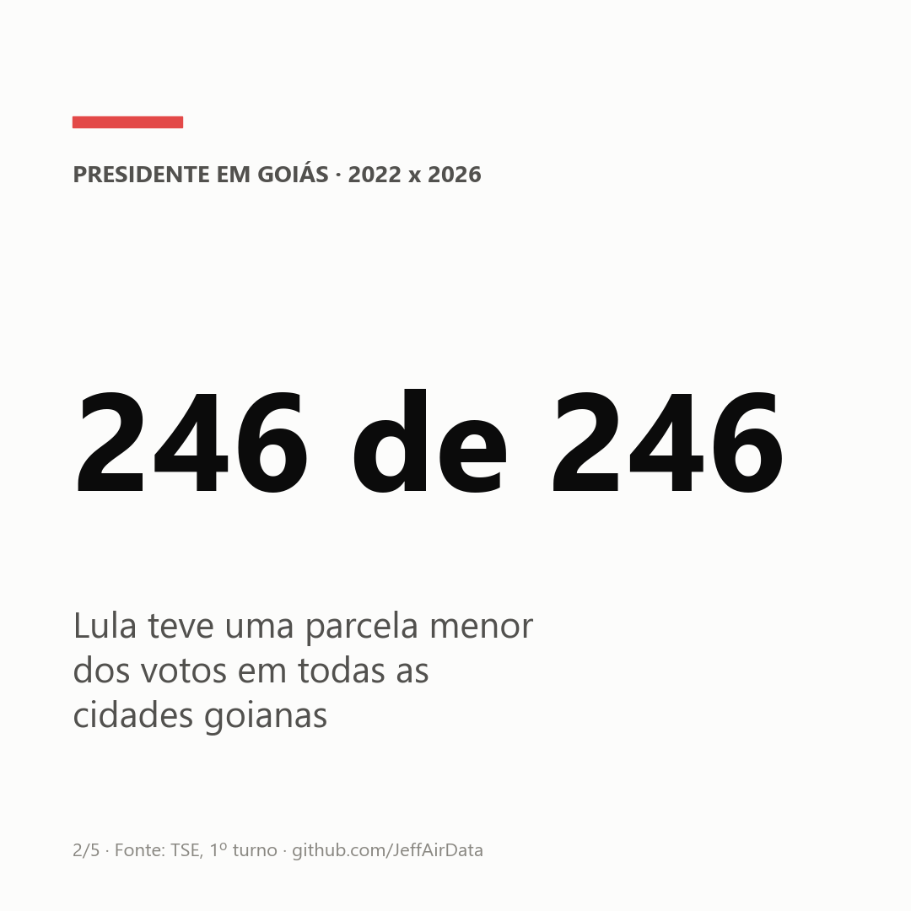
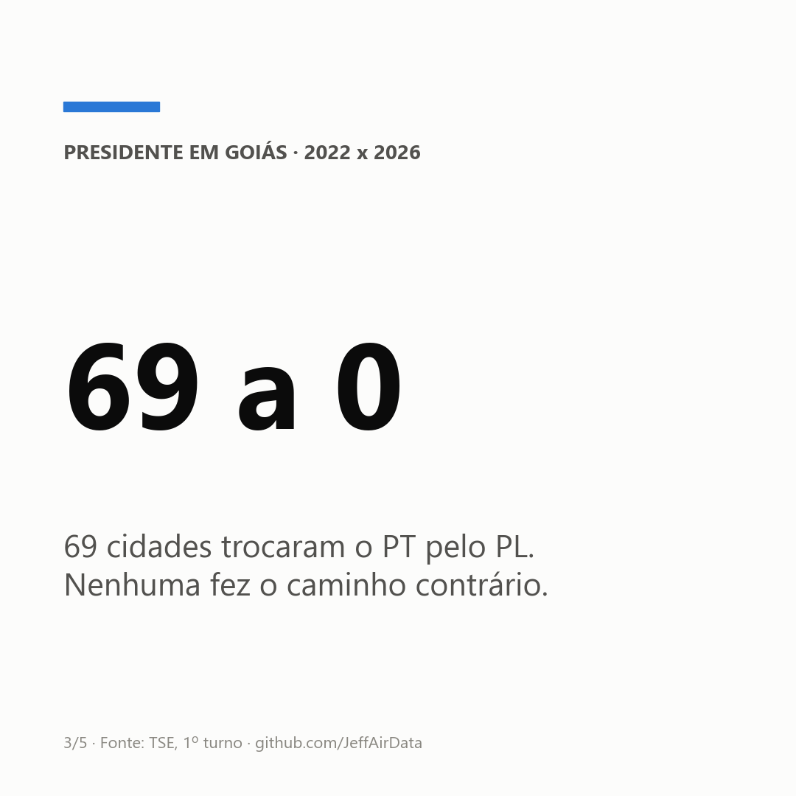
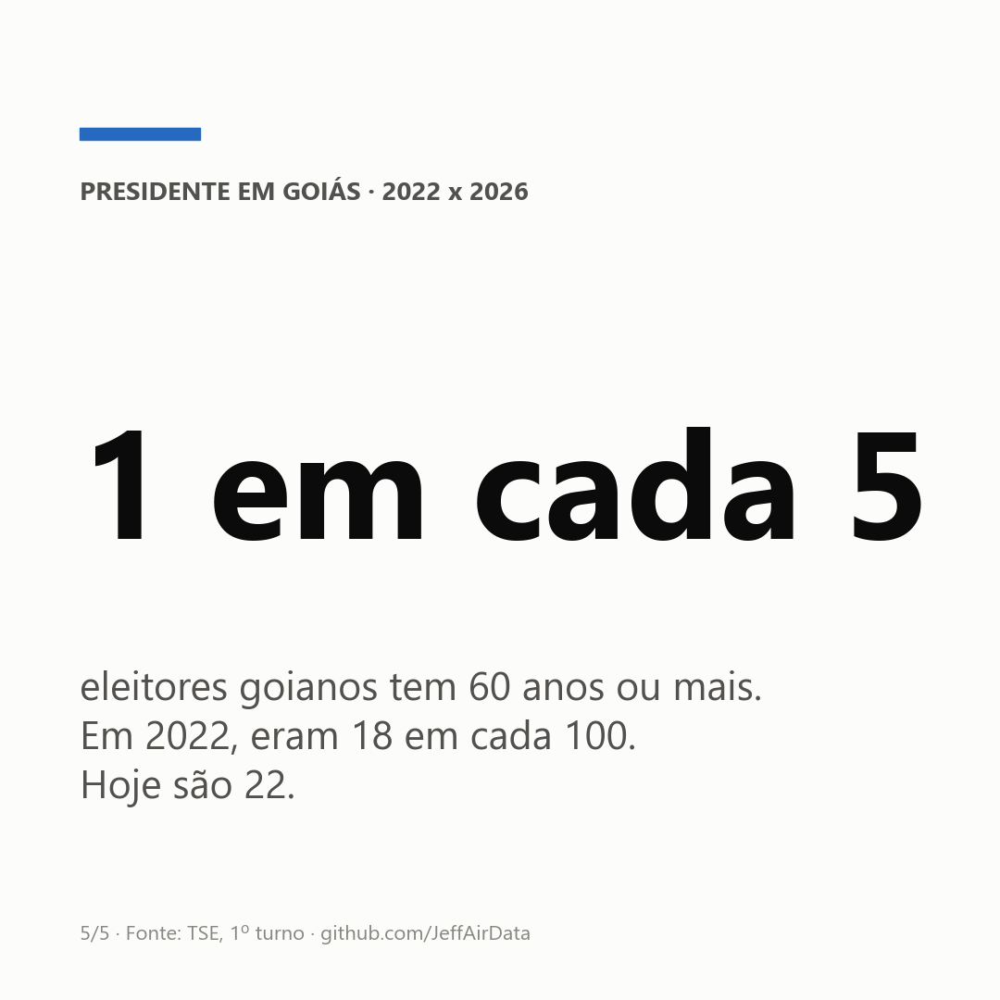
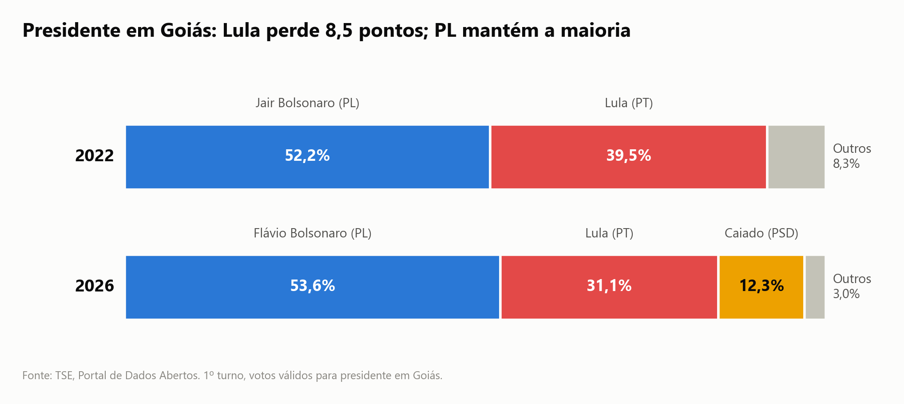
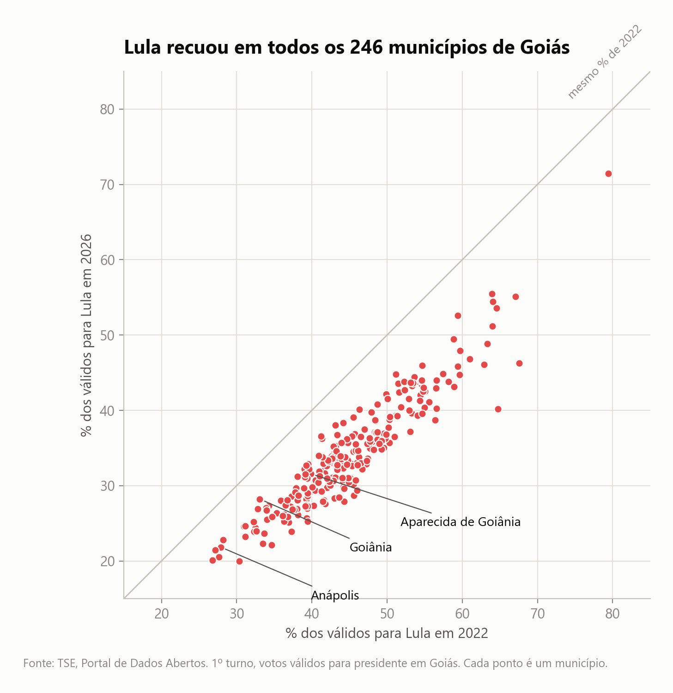
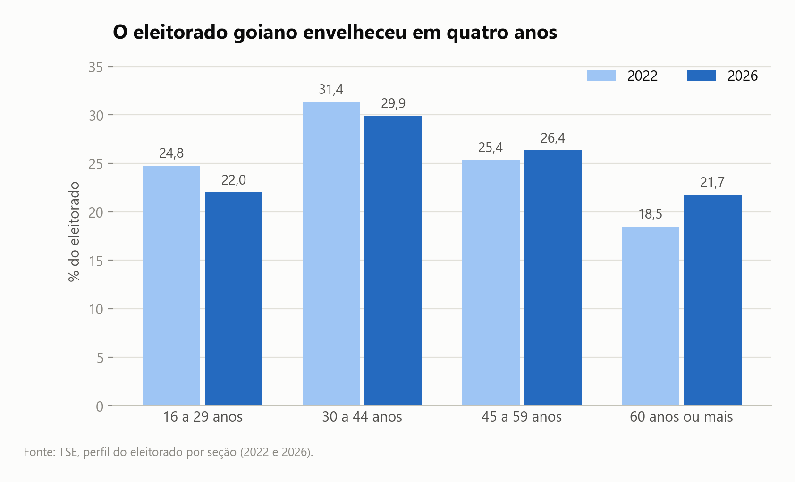

# Como Goiás votou para presidente: 2022 x 2026

**Em 2022, 4 de cada 10 votos para presidente em Goiás foram para Lula. Em 2026, foram 3.**

Lula era o mais votado em 97 das 246 cidades goianas. Agora é em 28. Nenhuma cidade fez o caminho contrário.

👉 **[Veja o resultado na sua cidade](https://jeffairdata.github.io/eleicoes-goias-2022-2026/)**



## Em cinco números

| | |
|---|---|
|  |  |
|  |  |
|  | |

## O que mudou

- **Lula perdeu espaço em todo o estado.** Teve uma parcela menor dos votos em todas as 246 cidades.
- **O PL ficou onde estava.** Jair Bolsonaro teve 52 de cada 100 votos em 2022; Flávio Bolsonaro, 54 em 2026.
- **Caiado entrou na disputa.** O ex-governador ficou com 12 de cada 100 votos, e chegou a 32 em Guarani de Goiás.
- **A abstenção não mudou.** Nas duas eleições, 22 de cada 100 eleitores não foram votar.
- **O eleitor ficou mais velho.** Quem tem 60 anos ou mais passou de 18 para 22 em cada 100 eleitores.



## As 10 maiores cidades

De cada 100 votos para presidente, quantos foram para cada um:

| Cidade | PL 2022 | PL 2026 | Lula 2022 | Lula 2026 | Caiado 2026 |
|---|---|---|---|---|---|
| Goiânia | 56,1 | 54,7 | 33,1 | 28,2 | 13,5 |
| Aparecida de Goiânia | 50,7 | 50,5 | 39,8 | 31,6 | 14,4 |
| Anápolis | 63,0 | 63,1 | 27,9 | 21,8 | 11,5 |
| Rio Verde | 55,6 | 63,7 | 37,7 | 26,8 | 5,3 |
| Luziânia | 53,9 | 51,4 | 38,1 | 31,2 | 14,9 |
| Águas Lindas de Goiás | 46,5 | 46,6 | 45,5 | 39,1 | 10,8 |
| Valparaíso de Goiás | 50,1 | 48,8 | 41,3 | 36,3 | 11,1 |
| Trindade | 49,8 | 49,2 | 41,1 | 31,3 | 16,7 |
| Senador Canedo | 48,6 | 48,4 | 42,8 | 34,1 | 14,2 |
| Formosa | 51,1 | 52,2 | 41,0 | 31,9 | 13,1 |




## Como ler estes números

- São do 1º turno e contam só os votos dados a algum candidato (sem brancos e nulos).
- Mostram onde o voto mudou, não quem mudou de voto.
- Os dados de 2026 são da extração do TSE de 11/10/2026 e podem ser atualizados.

---

## Para quem quer os dados

Em `Data/processed/`, em Parquet e CSV:

| Arquivo | Conteúdo |
|---|---|
| `presidente_go_votos` | votos válidos por município, candidato, ano e turno |
| `presidente_go_comparecimento` | aptos, comparecimento, abstenção, brancos e nulos por município |
| `eleitorado_go_perfil` | eleitorado por município: sexo, faixa etária e escolaridade |
| `resumo_municipios_go.csv` | uma linha por município com os indicadores dos gráficos |

Fonte: [Portal de Dados Abertos do TSE](https://dadosabertos.tse.jus.br/), arquivos `votacao_candidato_munzona`, `detalhe_votacao_munzona` e `perfil_eleitor_secao`. Malha municipal: IBGE 2020, via `geobr`.

### Como reproduzir

```bash
python -m venv .venv
.venv\Scripts\activate          # Linux/Mac: source .venv/bin/activate
pip install -r requirements.txt
python src/download_tse.py      # cerca de 1,1 GB
python src/build_dataset.py
python src/build_charts.py
```
